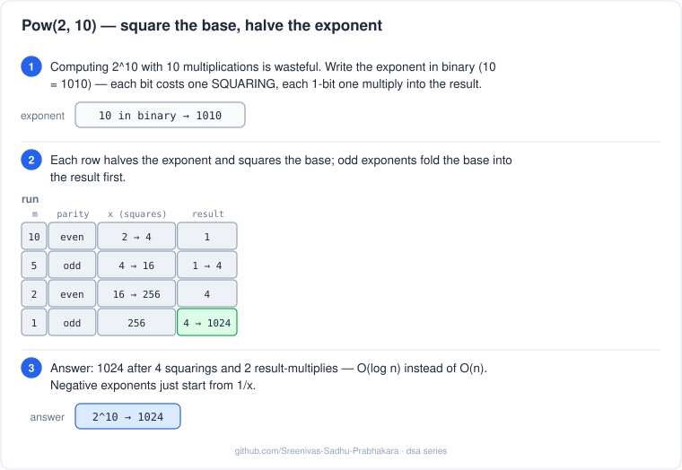

# Pow(x, n)

> Striver SDE Sheet 014 · Day 3 Arrays — exponentiation by squaring: halve the exponent, square the base, O(log n) multiplies. Go, stdlib only, tested.

## Problem

Compute xⁿ for a float base and an integer exponent — which may be negative, zero, or the most negative representable integer — without looping n times.

## Approach

Exponentiation by squaring: write n in binary; each bit costs one squaring of the base, and each set bit multiplies the running result. That is ⌊log₂n⌋ squarings instead of n multiplies. A negative exponent flips the base to 1/x first. The one real trap is negating the most negative int (its positive magnitude doesn't fit the signed type), handled by computing the magnitude as `uint64(-(n+1)) + 1`.

**Complexity:** O(log |n|) time, O(1) space.

## Visual walkthrough

Read the picture top to bottom — each numbered frame is one moment of the algorithm
running on this repo's test example.

## Run

    go test ./...   # verify
    go run .        # demo

---

One of 191 repos solving Striver's SDE Sheet in Go — stdlib only, one problem per repo, every solution tested. Browse the set: [`dsa-*` repos](https://github.com/Sreenivas-Sadhu-Prabhakara?tab=repositories&q=dsa-&type=source).
